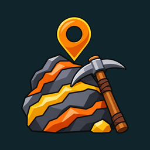
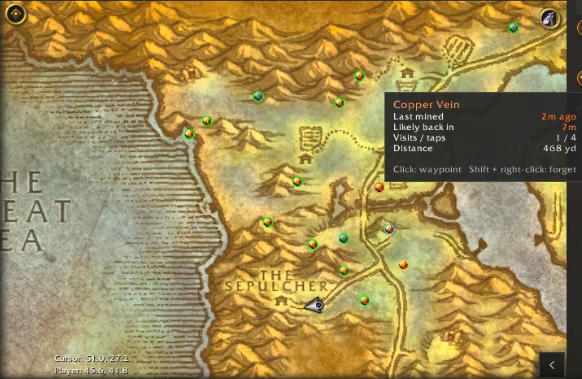

# VeinKeeper

A lightweight World of Warcraft: Forever addon that remembers every ore vein you find and shows it on your world map and minimap, with respawn timers.

## Install

**WowUp:** on your WoW Forever installation, choose *Get Addons > Install from URL* and paste `https://github.com/Phiir42/VeinKeeper`. WowUp keeps it updated from then on.

**By hand:** download `VeinKeeper-<version>-forever.zip` from [Releases](https://github.com/Phiir42/VeinKeeper/releases) and extract it into `World of Warcraft\_forever_\Interface\AddOns`.

## Features

**Recording**
- Saves a spot when you finish mining a node. Works in any client language. Shared spawn points (Tin/Silver, Mithril/Truesilver) merge into one spot, re-hitting a multi-tap vein counts as one visit, and the position is averaged over your first visits.
- With Find Minerals on, hovering a vein's yellow dot on the minimap saves it too, to within a few yards. It gets a blue ring until you mine it. Hovering a known spot's dot marks it as up.

**Pins**
- The game's own ore icon for each node, cut round. Season of Discovery quest nodes use VeinKeeper's drawn icons; `/vk icons` uses the drawn set everywhere.
- The ring shows freshness: red when just mined, yellow when soon, green when likely back, blue when seen but never mined.
- World map pins also appear on neighbouring zones and continent maps. Hover for ores seen, time since mined, fastest respawn seen, visits and distance. Click for a waypoint (TomTom if installed); shift + right-click forgets the spot.
- On the minimap, the nearest far spots sit on the rim with their distance, limited to spots likely back within 500 yd by default.
- With Find Minerals on, spots in view become hollow rings so the game's yellow dot shows inside when the vein is up.
- Spots above your Mining skill are dimmed.

**Tools**
- `/vk route`, or a key under Key Bindings > AddOns: a farm route, a short loop through every spot in your zone you can mine, drawn on the world map. The waypoint moves on when you mine a stop, reach one that isn't back yet, or walk past one that was empty; veins you find on the way join the loop. Works with the ore filter.
- `/vk next`, or a key under Key Bindings > AddOns: a waypoint to the nearest spot likely back. Ask again at an empty spot and it skips it.
- Ore filter: show just one ore, all its vein types together. Use the world map button's right-click menu, the settings window, or `/vk only thorium`.
- Share spots: `/vk export` (or Export in the settings window) gives your spots as text to copy into Discord or a forum post; `/vk import` merges someone's text into yours. Only positions and ores travel, never your timers. New spots arrive as blue rings and become yours once you mine them; `/vk clear imported` removes the ones you never visited.
- Yield: the loot of every vein you mine is counted per vein type. Tooltips show the average ore a visit once a type has 3 visits; `/vk yield` lists everything each type gives (stone and gems as a chance a visit) and this session's haul with ore an hour.
- `/vk prune [days]`: delete spots visited only once and not seen for 30 days (or `[days]`).

**Light on your game:** no work while you stand still, nothing while the world map is closed, and no libraries.

## Settings and commands

Open settings with `/vk`, the minimap button, the world map button (top right) or the addon compartment. The minimap button works with button collectors such as EllesmereUI.

| Command | What it does |
|---|---|
| `/vk next` | Waypoint to the nearest spot likely back |
| `/vk route` / `route off` | Start / stop a farm route through this zone (`/vk next` skips a stop) |
| `/vk export [zone]` | Your spots (those shown, or this zone's) as text to share |
| `/vk import` | Merge someone's export into your spots |
| `/vk yield` / `yield reset` | Average loot a visit per vein type, and this session's |
| `/vk near` | List the closest spots |
| `/vk only <ore>` | Show one ore only (`/vk only all` to reset) |
| `/vk ignore <node>` / `unignore <node>` | Stop / resume recording a node type |
| `/vk map`, `minimap`, `icons`, `skill`, `seen`, `button` | Toggle a setting |
| `/vk ready <minutes>`, `edge <0-10>` | Respawn timer, rim pin count |
| `/vk inrange ring \| hide \| icon` | How spots in view look with Find Minerals on |
| `/vk prune [days]` | Delete single-visit spots older than 30 days |
| `/vk clear zone \| seen \| imported \| all` | Delete spots |
| `/vk cpu` | Measure VeinKeeper's CPU use for 30 seconds |
| `/vk help` | List all commands |

## Translating

VeinKeeper records veins in any client language, and its own text is translated into German, French, Italian, Spanish (esES, esMX), Brazilian Portuguese, Russian, Korean and Chinese (zhCN, zhTW). These are first drafts: if a line reads wrong in your language, fix it in `VeinKeeper/Locales/<code>.lua` and open a pull request. To add a language:

1. `python tools/locales.py new deDE` (your client's `GetLocale()` code: deDE, frFR, esES, esMX, ruRU, ptBR, itIT, koKR, zhCN, zhTW) makes `VeinKeeper/Locales/deDE.lua` with every English text, one per line, commented out.
2. For each line you translate, remove the `--` and write your text between the quotes. Keep `%s`, `%d`, `%.1f` and `%%` in the same order; a line where they differ isn't used. Lines you leave stay English. Slash commands (`/vk route`...) stay English.
3. `python tools/locales.py` checks your file. Open a pull request with it.

When the English text changes, `python tools/locales.py update` adds the new text to every locale file and keeps the translations. Vein names show in your language once you've mined each kind, as the game names them.

See the [changelog](CHANGELOG.md) for what's new.
