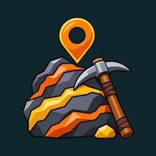
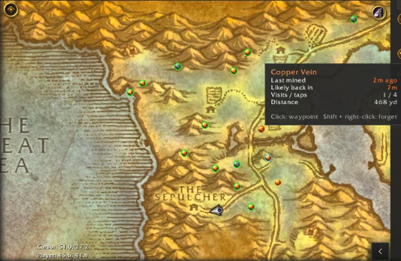

# VeinKeeper

A lightweight World of Warcraft: Forever addon that remembers every ore vein you find and shows it on your world map and minimap, with respawn timers.

## Install

**WowUp:** on your WoW Forever installation, choose *Get Addons > Install from URL* and paste `https://github.com/Phiir42/VeinKeeper`. WowUp keeps it updated from then on.

**By hand:** download `VeinKeeper-<version>-forever.zip` from [Releases](https://github.com/Phiir42/VeinKeeper/releases) and extract it into `World of Warcraft\_forever_\Interface\AddOns`.

## Features

**Recording**
- Saves a spot when you finish mining a node. Works in any client language. Shared spawn points (Tin/Silver, Mithril/Truesilver) merge into one spot, re-hitting a multi-tap vein counts as one visit, and the position is averaged over your first visits.
- With Find Minerals on, hovering a vein's yellow dot on the minimap saves it too, to within a few yards. It gets a blue ring until you mine it. Hovering a known spot's dot marks it as up.

**Pins**
- The game's own ore icon for each node, cut round. Season of Discovery quest nodes use VeinKeeper's drawn icons; `/vk icons` uses the drawn set everywhere.
- The ring shows freshness: red when just mined, yellow when soon, green when likely back, blue when seen but never mined.
- World map pins also appear on neighbouring zones and continent maps. Hover for ores seen, time since mined, fastest respawn seen, visits and distance. Click for a waypoint (TomTom if installed); shift + right-click forgets the spot.
- On the minimap, the nearest far spots sit on the rim with their distance, limited to spots likely back within 500 yd by default.
- With Find Minerals on, spots in view become hollow rings so the game's yellow dot shows inside when the vein is up.
- Spots above your Mining skill are dimmed.

**Tools**
- `/vk next`, or a key under Key Bindings > AddOns: a waypoint to the nearest spot likely back. Ask again at an empty spot and it skips it.
- Ore filter: show just one ore, all its vein types together. Use the world map button's right-click menu, the settings window, or `/vk only thorium`.
- `/vk prune [days]`: delete spots visited only once and not seen for 30 days (or `[days]`).

**Light on your game:** no work while you stand still, nothing while the world map is closed, and no libraries.

## Settings and commands

Open settings with `/vk`, the minimap button, the world map button (top right) or the addon compartment. The minimap button works with button collectors such as EllesmereUI.

| Command | What it does |
|---|---|
| `/vk next` | Waypoint to the nearest spot likely back |
| `/vk near` | List the closest spots |
| `/vk only <ore>` | Show one ore only (`/vk only all` to reset) |
| `/vk ignore <node>` / `unignore <node>` | Stop / resume recording a node type |
| `/vk map`, `minimap`, `icons`, `skill`, `seen`, `button` | Toggle a setting |
| `/vk ready <minutes>`, `edge <0-10>` | Respawn timer, rim pin count |
| `/vk inrange ring \| hide \| icon` | How spots in view look with Find Minerals on |
| `/vk prune [days]` | Delete single-visit spots older than 30 days |
| `/vk clear zone \| seen \| all` | Delete spots |
| `/vk help` | List all commands |

See the [changelog](CHANGELOG.md) for what's new.
